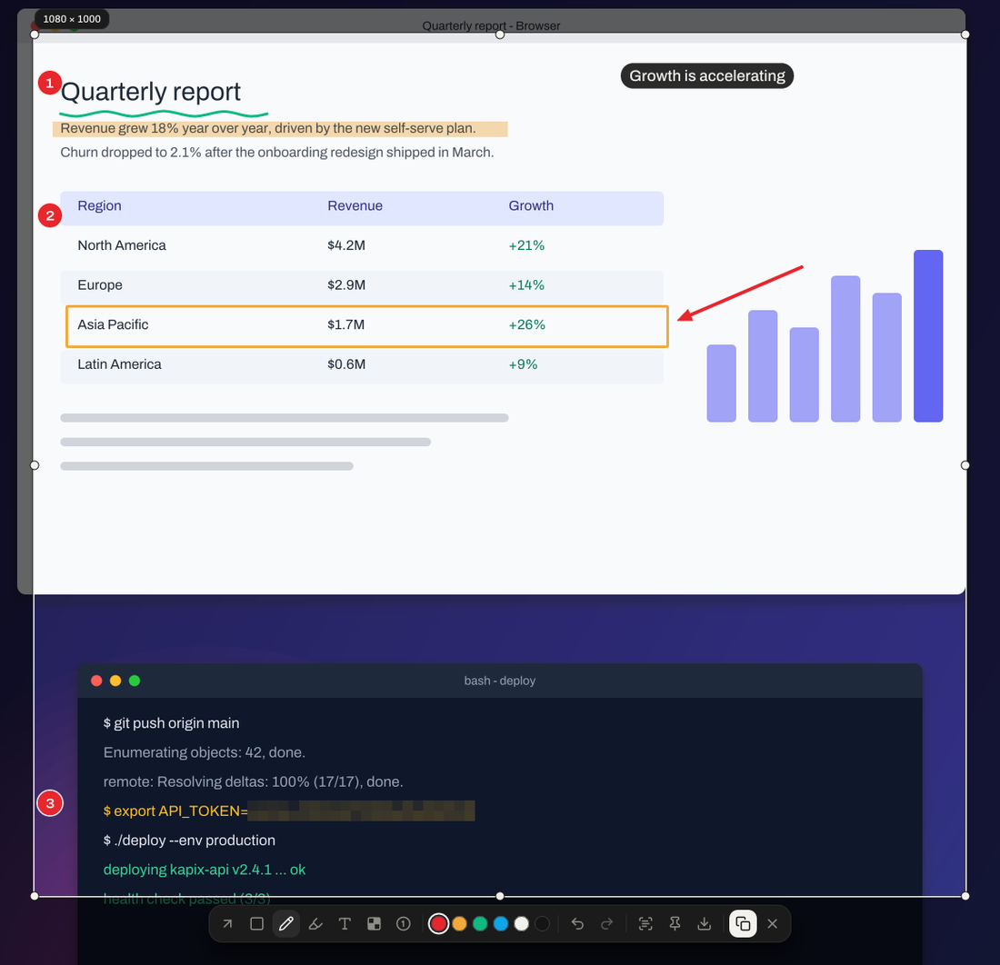
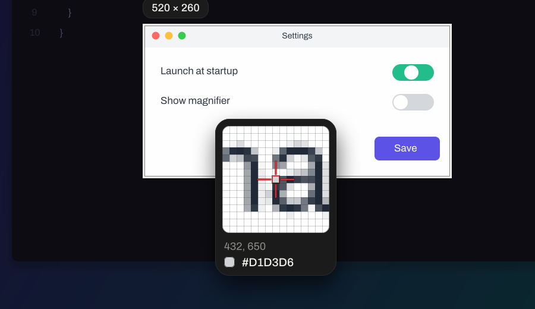
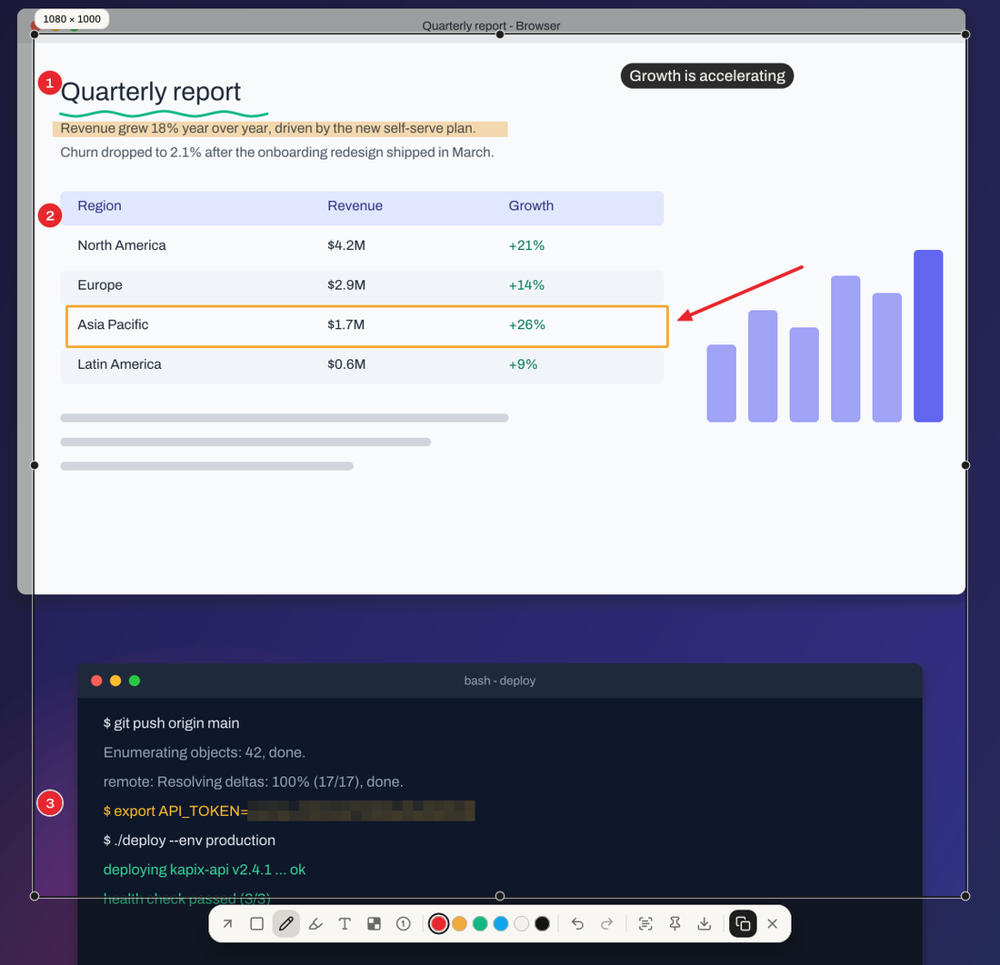
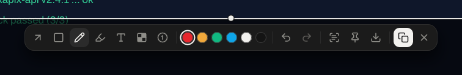
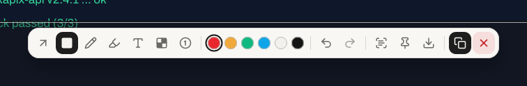

<p align="center">
  
</p>

<p align="center">
  
  
  
  
  <a href="LICENSE"></a>
</p>

<p align="center">
  <a href="#screenshots">Screenshots</a> ·
  <a href="#hotkeys">Hotkeys</a> ·
  <a href="#cli">CLI</a> ·
  <a href="#workspace">Workspace</a> ·
  <a href="#building--installing">Building &amp; Installing</a> ·
  <a href="docs/PRD.md">PRD</a> ·
  <a href="#license">License</a>
</p>

---

Instant screenshot, annotation & OCR tool for Windows and Linux (Wayland) — 100% pure Rust, one binary, no runtime.

Kapix = **Ka**rel + **pix** (pixels). Same family as Kavox and Kadex: the same tokens, Archivo
typeface and one red accent, with light/dark following the system theme.

- Hotkey → frozen overlay, drag, copy. Snaps to windows, magnifier loupe with HEX sampler.
- Annotate without menus: arrow, rectangle, pen, highlighter, text, irreversible pixelate, step badges, floating pin windows.
- One-hotkey offline OCR via `Windows.Media.Ocr` on Windows or `tesseract` on Linux — zero bundled models.
- ~1.2 MB `.exe` (Windows) / ~1.6 MB ELF (Linux, links only `libc`/`libm`/`libgcc_s` — no `libwayland`, GTK, Qt, or WebView), no network access, no telemetry.

Full requirements: [docs/PRD.md](docs/PRD.md).

## Screenshots

<p align="center">
  
</p>

<table>
  <tr>
    <td width="50%"></td>
    <td width="50%"></td>
  </tr>
  <tr>
    <td align="center">Window snap, loupe and HEX sampler</td>
    <td align="center">Light theme follows the system</td>
  </tr>
</table>

<p align="center">
  
  
</p>

<sub>Rendered by Kapix's own UI code (<code>cargo run --release -p kapix-ui --example snapshots</code>) over a synthetic desktop.</sub>

## Hotkeys

On Windows, Kapix registers these global hotkeys from the tray daemon. On Linux (Wayland), bind the
CLI subcommands in your compositor (ready-to-paste Niri config in [`packaging/niri/kapix.kdl`](packaging/niri/kapix.kdl)):

| Default | Action | Linux compositor command |
| :--- | :--- | :--- |
| `Ctrl+Shift+S` | Region capture (overlay) | `kapix capture --mode region --copy` |
| `Ctrl+Shift+O` | OCR a region → text on clipboard | `kapix capture --mode ocr --copy` |
| `Ctrl+Shift+F` | Capture the monitor under the cursor | `kapix capture --mode fullscreen --copy` |
| `Ctrl+Shift+A` | Capture the active window | `kapix capture --mode window --copy` |

Inside the overlay: `Enter`/`Ctrl+C` copy · `Ctrl+S` save · `O` OCR · `Ctrl+P` pin · `C` copy HEX ·
`A R P H T B N` tools · `1`–`6` colors · wheel = size · `F` fill/backing · `Ctrl+Z`/`Ctrl+Y` ·
arrows nudge (`Shift` ×10) · `Esc`/right-click cancel.

Config lives at `%APPDATA%\Kapix\config.toml` on Windows and `${XDG_CONFIG_HOME:-~/.config}/kapix/config.toml` on Linux
(reloaded automatically on every capture).

## CLI

```
kapix                                  # Windows: tray daemon · Linux: interactive region capture
kapix capture --mode region --copy
kapix capture --mode ocr --stdout
kapix capture --mode window --out shot.png
kapix capture --mode fullscreen [--gdi] --out shot.jpg
kapix quit                             # Windows: stop the running tray daemon
```

## Workspace

| Crate | Layer | Contents |
| :--- | :--- | :--- |
| `kapix-core` | backend, pure Rust | geometry, BGRA images + PNG, pixelate, annotation model + undo, config, hotkeys, templates |
| `kapix-win` | backend, Windows | DXGI Desktop Duplication (+HDR) with GDI fallback, window snap, clipboard (`CF_DIBV5` + `PNG`), WinRT OCR, WIC JPEG, dialogs, registry |
| `kapix-linux` | backend, Linux | pure-Rust Wayland screencopy (`zwlr_screencopy_manager_v1`), `memfd` SHM swapchain, Niri/Hyprland/Sway window snap, `wl-copy` clipboard, `tesseract` OCR, `jpeg-encoder`, XDG paths, TZif local time |
| `kapix-ui` | frontend, pure Rust | overlay state machine, `tiny-skia` renderer (shared by preview and export), loupe, toolbar, toasts |
| `kapix-app` | entrypoint | Win32 tray daemon + hosts (overlay, toast, pin), Wayland `zwlr_layer_shell_v1` overlay + `xdg_shell` pin host, CLI |

`kapix-core` and `kapix-ui` are platform-independent: `cargo run --release -p kapix-ui --example snapshots` writes PNGs
to `snapshots-out/`, and `--example bench_paint` measures 4K repaint times.

## Building & Installing

### Linux (Wayland — Niri, Hyprland, Sway, wlroots compositors)

No C compiler or system GUI `-dev` libraries are required — only a Rust toolchain.

```bash
# Build and install per-user to ~/.local/bin + ~/.local/share (no sudo):
./packaging/linux/install.sh

# Rebuild after pulling changes, or remove:
./packaging/linux/install.sh --rebuild
./packaging/linux/install.sh --uninstall
```

Or build an Arch Linux package with `makepkg -si` inside [`packaging/arch/`](packaging/arch/PKGBUILD).
For Niri, paste the floating pin window rule and keybinds from [`packaging/niri/kapix.kdl`](packaging/niri/kapix.kdl) into `~/.config/niri/config.kdl`.

Optional runtime helpers (all degrade gracefully when absent):
- `wl-clipboard` (`wl-copy`) — clipboard copy
- `tesseract` (`+ tesseract-data-eng`) — offline OCR
- `libnotify` (`notify-send`) — capture notifications
- `zenity` or `kdialog` — interactive Save As dialog (falls back to saving directly into `~/Pictures/Kapix`)

### Windows

Download `kapix-<version>-windows-x64-setup.exe` from the [Releases](https://github.com/Aitemaa/Kapix/releases) page and run it. No admin rights are needed: it installs for your user into `%LOCALAPPDATA%\Programs\Kapix` (choose "for all users" on the first page to install into Program Files instead). It adds:

- a Start menu entry, so **Kapix** shows up in Windows search and `Win+R` (`kapix`)
- optional: a desktop shortcut and starting at sign-in (keeps `Ctrl+Shift+S` / `Ctrl+Shift+O` hotkeys ready)
- an uninstaller in **Settings → Apps**. Uninstalling never deletes your config in `%APPDATA%\Kapix` or your saved screenshots.

A portable zip (`kapix-<version>-windows-x64.zip`) and standalone `kapix.exe` / `kapix-arm64.exe` are attached to each release as well. To build from source:

```
cargo build --release -p kapix-app          # on Windows → target/release/kapix.exe
```

To build the Inno Setup 6 installer locally on Windows:

```powershell
& "${env:ProgramFiles(x86)}\Inno Setup 6\ISCC.exe" /DAppVersion=0.1.1 /DSourceDir="$PWD\target\release" /DOutputDir="$PWD\target\release" packaging\windows\kapix.iss
```

Cross-compiling from Linux: `cargo xwin build --release -p kapix-app --target x86_64-pc-windows-msvc`
(needs `cargo install cargo-xwin`, `clang`, `lld`).

CI (`.github/workflows/ci.yml`) runs fmt, clippy, all tests on Windows and Linux, a pure-Rust dependency
check, the PRD size gate (warn > 2.5 MiB, fail > 4 MiB), `ldd` check on Linux, CLI capture smoke tests,
and builds the Windows installer. Tagging `vX.Y.Z` builds `kapix-<ver>-windows-x64-setup.exe`,
`kapix-<ver>-windows-x64.zip`, `kapix.exe`, `kapix-arm64.exe`, and `kapix-<ver>-linux-x64.tar.gz` with
SHA-256 sums into a draft release.

## Deviations from the PRD

- **No `arboard`:** clipboard is written directly with Win32 (`CF_DIBV5` + `PNG`) on Windows and via `wl-copy` on Linux without arboard's `image` dependency.
- **No `softbuffer` / `winit`:** buffers are blitted directly with `SetDIBitsToDevice` on Windows and pure-Rust `wayrs-client` + `memfd` SHM on Linux — zero C FFI or GUI toolkit dependencies.
- **`tiny-skia` and `kapix-ui` compile at `opt-level = 3`** (rest is `z`): ~4× faster 4K repaints
  for ~160 KB.

## Status

Windows and Linux (Wayland/Niri) backends are implemented end to end. On Linux, Wayland screencopy, layer-shell overlay, pin window, and packaging are verified on Niri; the manual Windows hardware matrix in PRD §11 (mixed DPI, negative coordinates, HDR, RDP, rotated monitors) is still to do.

## License

MIT. The bundled Archivo typeface (Latin subset in `assets/fonts`) is under the SIL Open Font
License — see `assets/fonts/OFL.txt`.
