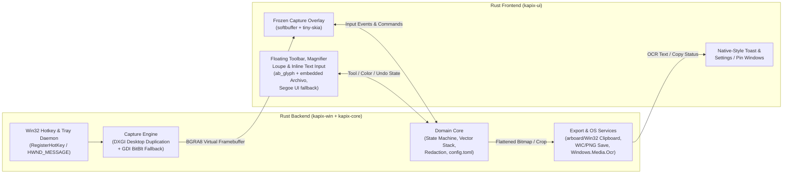
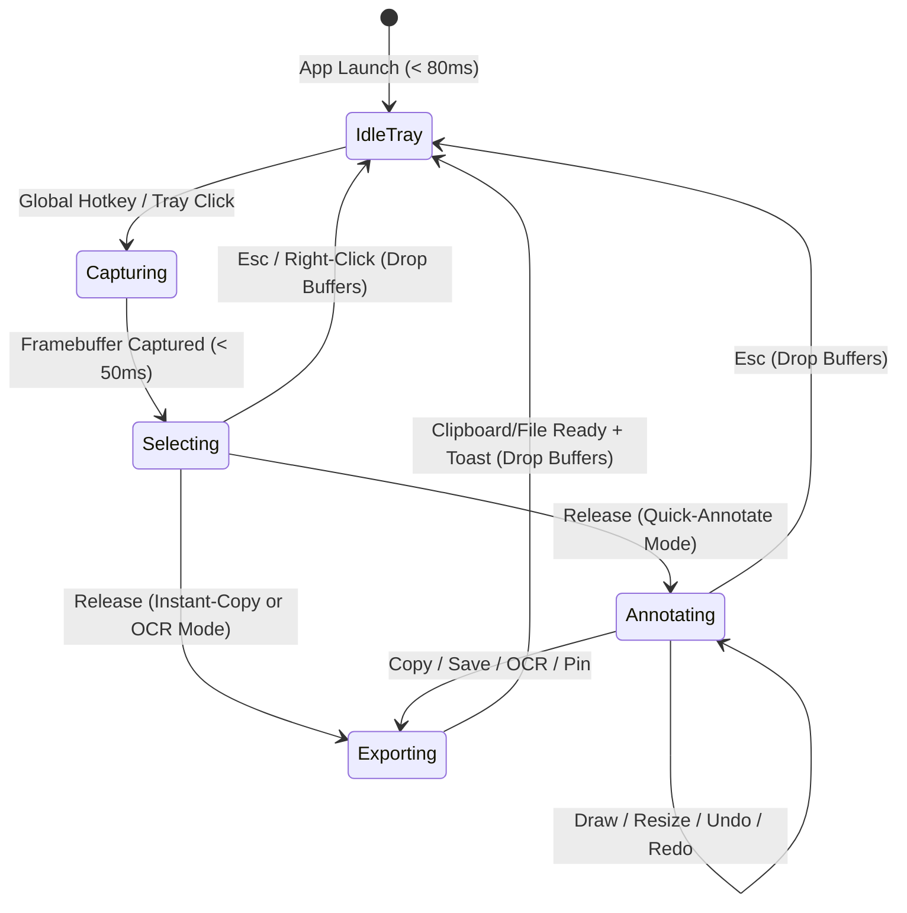

# Product Requirements Document (PRD): Kapix

**Product Name:** Kapix — Instant Screenshot, Annotation & OCR Tool for Windows  
**Document Status:** Draft v1.2 (All-Rust FE + BE)  
**Date:** 2026-11-23  
**Target Platform:** Windows 10 (1903 / Build 18362+) & Windows 11 (x64 & ARM64)  
**Primary Stack (100% Rust — FE & BE):**
- **Rust Backend (`kapix-core`, `kapix-win`):** `windows` crate (DXGI Desktop Duplication, GDI `BitBlt`, Win32 hotkeys/tray/DWM, WinRT `Windows.Media.Ocr`, WIC), `arboard`, `png`/`fdeflate`, `serde` + `toml`
- **Rust Frontend (`kapix-ui`, `kapix-app`):** `softbuffer` + `tiny-skia` + `ab_glyph` (embedded Kavox-family Archivo typeface, Segoe UI from Windows for non-Latin fallback; pure-Rust `egui` evaluated as alternative) — **zero HTML/CSS/JS, zero WebView2/Electron/Tauri, zero .NET/C++ UI layers**

---

## 1. Executive Summary

Built-in **Windows Snipping Tool** suffers from noticeable launch lag (WinUI/UWP cold-start overhead), awkward post-capture workflows, and slow OCR discovery. Conversely, **ShareX** is powerful but built on .NET, ships with a large footprint, and buries everyday actions under 100+ nested menus and cloud-uploader settings most users never touch.

**Kapix** replaces both for the 95% everyday workflow: **instant screen capture, minimal high-signal annotation, irreversible redaction, and zero-bundle built-in OCR**. Both the **frontend (overlay, annotation canvas, floating toolbar, loupe, toasts, tray, settings, pin windows)** and the **backend (screen capture, hotkeys, OCR, clipboard, image encoding, config)** are written **100% in Rust**, compiling into a **single portable native executable under 3 MB** with **< 50 ms hotkey-to-overlay latency** and **< 10 MB idle memory**.

---

## 2. Problem Statement & Competitive Baseline

### Pain Points Being Solved
1. **Capture Latency Kills Flow:** Pressing `Win+Shift+S` on Windows frequently stalls for 300–1,200 ms while the Snipping Tool UWP process wakes or initializes—long enough for hover menus, tooltips, and transient UI states to disappear.
2. **Runtime & Disk Bloat:** Modern utilities bundle Electron/WebView2 (100+ MB), .NET runtimes (70–150 MB), or standalone OCR ML models (50–200 MB).
3. **Configuration Overload:** ShareX exposes dozens of capture workflows, upload destinations, and context submenus when users overwhelmingly want: *capture → (optionally draw/blur) → copy to clipboard → move on*.

### Competitive Benchmark Targets

| Metric | Windows Snipping Tool | ShareX | **Kapix (Target)** |
| :--- | :--- | :--- | :--- |
| **Hotkey → Frozen Overlay (P95)** | 350–1,200 ms | 120–300 ms | **≤ 50 ms** (stretch: `< 30 ms`) |
| **Installed / Bundle Size** | System UWP package (~40+ MB + WinUI) | ~35 MB + .NET Desktop Runtime (~150 MB) | **≤ 2.5 MB** single `.exe` (hard cap: `4.0 MB`) |
| **Idle Resident RAM (Tray)** | ~45–90 MB (when warm) | ~60–110 MB | **≤ 8 MB** (hard cap: `15 MB`) |
| **Runtime Dependencies** | WinUI / Windows App SDK | .NET 8/9 Desktop Runtime | **None** (OS Win32/DXGI/WinRT DLLs only) |
| **Instant OCR** | Multi-click inside editor | Requires external/plugin setup | **1-hotkey native `Windows.Media.Ocr` (0 B ML bundle)** |
| **UI Complexity** | Minimal, sluggish | 100+ menus / deep trees | **1 compact floating bar + keyboard-first** |

---

## 3. Target Users & Core Jobs-to-be-Done

- **Software Engineers & QA:** Capture bug repros, annotate with arrows/step numbers, redact API keys/tokens, copy terminal/error text via OCR, and paste straight into GitHub/Slack/Linear.
- **Designers & PMs:** Inspect exact pixel dimensions, sample HEX/RGB colors, snap cleanly to application windows, and pin visual references on top of other windows.
- **Technical Writers & Support:** Produce crisp, consistent annotated screenshots quickly without wrestling with menus or waiting for an editor to load.

---

## 4. Non-Functional Requirements & Hard Budgets

These are **release-blocking gates** enforced in CI. Any PR that violates a hard cap requires an explicit waiver or optimization before merge.

### 4.1 Performance Budgets (Measured on Mid-Range Windows 11, 1440p/4K)
- **Cold start to system tray ready:** `≤ 80 ms`
- **Hotkey press → frozen overlay rendered (P95):** `≤ 50 ms`
- **Mouse release → clipboard image ready (Instant mode):** `≤ 40 ms`
- **OCR region release → extracted text in clipboard (P95, typical UI snippet):** `≤ 250 ms`
- **Overlay interaction frame pacing:** `60–144 FPS` with zero GC pauses during drag/annotation
- **Idle CPU usage (tray resident):** `0.0%` (strictly event-driven Win32 message loop; zero polling timers)

### 4.2 Bundle Size & Memory Budgets
- **Release binary size (`kapix.exe`, stripped, x64):** Target `≤ 2.5 MB`, hard cap `4.0 MB`
- **Idle working set (tray resident):** Target `≤ 8 MB`, hard cap `15 MB`
- **Active capture peak RAM:**
  - Single 1080p/1440p monitor: `≤ 45 MB`
  - Single 4K monitor: `≤ 70 MB`
  - Dual 4K monitors: `≤ 130 MB`
- **Memory reclamation:** Framebuffer and annotation surfaces **must be dropped immediately** upon overlay close, returning process working set to idle baseline (`≤ 10 MB`).

### 4.3 Reliability & Compatibility
- Windows 10 1903+ and Windows 11 (x64 primary, ARM64 supported).
- Full **Per-Monitor DPI Awareness v2** (`PerMonitorV2`) support across mixed-scaling setups (e.g., 150% laptop + 100% 4K external monitor) and negative virtual screen coordinates.
- HDR monitor support (proper scRGB/HDR-to-SDR tone mapping instead of blown-out white captures).
- Graceful recovery from GPU driver resets (`DXGI_ERROR_DEVICE_REMOVED` / `DXGI_ERROR_ACCESS_LOST`), RDP sessions, and monitor hot-plugging.

---

## 5. Functional Requirements

### 5.1 P0 — Core Capture & Clipboard (MVP)

| ID | Feature | Requirements |
| :--- | :--- | :--- |
| **CAP-01** | **Instant Freeze-Frame Region Capture** | Global hotkey (default `Ctrl+Shift+S`, optional `PrintScreen` override) captures the entire virtual desktop immediately and freezes it inside a borderless topmost overlay so hover tooltips and dropdown menus never vanish. |
| **CAP-02** | **Smart Window Auto-Snap** | While hovering before dragging, highlight the bounding rectangle of the window under the cursor using `EnumWindows` + `DwmGetWindowAttribute(DWMWA_EXTENDED_FRAME_BOUNDS)` (excluding invisible shadow margins). Single-click captures the snapped window; dragging switches to freeform region selection. |
| **CAP-03** | **Precision Magnifier Loupe & Color Sampler** | A compact zoom loupe near the cursor displays a magnified pixel grid, live `W × H` dimensions, cursor `(X, Y)`, and HEX/RGB color under the crosshair. Pressing `C` copies the HEX color directly and dismisses the overlay. |
| **CAP-04** | **Selection Adjustment** | After dragging, user can resize via 8 corner/edge handles, drag to reposition, or nudge by `1 px` (`Arrow keys`) / `10 px` (`Shift+Arrows`). |
| **CAP-05** | **Fullscreen & Active Window Hotkeys** | Dedicated hotkeys for instant full virtual/current-monitor capture (`Ctrl+Shift+F`) and active foreground window capture (`Ctrl+Shift+A`) with optional instant clipboard copy. |
| **CAP-06** | **Dual Workflow Modes** | Configurable default behavior on mouse release: **(a) Quick-Annotate Mode** (default: selection stays active with compact floating toolbar; `Enter` or `Ctrl+C` copies & closes) or **(b) Instant-Copy Mode** (release mouse → immediately copy to clipboard & close; hold `Alt` to enter annotate mode). |
| **CAP-07** | **Rich Clipboard Output** | Copies image to Windows clipboard so it pastes cleanly into Electron/web apps (Slack, Discord, Notion, Chrome), Office, Paint, and native Win32 apps—writing PNG + DIB formats cleanly. |
| **CAP-08** | **Quick Save & Auto-Save** | `Ctrl+S` saves PNG immediately (or opens native `GetSaveFileNameW` dialog). Optional background auto-save to a configured directory with filename templates (e.g., `Kapix_{YYYY-MM-DD}_{HH-mm-ss}.png`). |

### 5.2 P0 — Minimal High-Signal Annotation Suite

No nested menus, no ribbon, no modal toolboxes. A single compact floating pill toolbar anchors cleanly outside the selection box (auto-flipping inside/above if near screen edges).

| Key | Tool | Behavior |
| :--- | :--- | :--- |
| `A` | **Arrow** | Crisp anti-aliased vector arrow with proportional arrowhead (`Shift` snaps to 45° increments). |
| `R` | **Rectangle** | Rounded or sharp outline rectangle (`Shift` constrains to square; toggle fill with `F`). |
| `P` | **Freehand Pen** | Smooth path-simplified vector stroke. |
| `H` | **Highlighter** | Wide semi-transparent stroke composited to keep underlying text legible. |
| `T` | **Text Callout** | Inline borderless text input rendered with crisp system typography and optional high-contrast backing pill. |
| `B` | **Pixelate / Blur Redaction** | Mosaic pixelation (default, cryptographically safer than Gaussian blur) over sensitive content (API keys, emails, PII). Applied destructively to output buffer before encoding. |
| `N` | **Step Counter** | Click to place auto-incrementing numbered badges (`1`, `2`, `3`...) for step-by-step guides and bug reports. |

**Editing Ergonomics:**
- **Stroke width / mosaic block size:** Mouse `Scroll Wheel` adjusts size on the fly with live cursor preview.
- **Color palette:** 6 curated high-contrast presets (`1`–`6` keys or single click: Red, Amber, Emerald, Sky, White, Ink) — no bloated color wheel modal.
- **Vector Undo / Redo:** `Ctrl+Z` / `Ctrl+Y` backed by an ordered command stack; annotations remain sharp and editable until flattened at export.
- **Dismiss:** `Esc` or `Right-Click` cancels cleanly and frees all capture buffers immediately.

### 5.3 P0 — Instant Built-In OCR (`Windows.Media.Ocr`)

| ID | Feature | Requirements |
| :--- | :--- | :--- |
| **OCR-01** | **Dedicated Instant OCR Hotkey** | Pressing `Ctrl+Shift+O` opens the capture overlay in OCR mode. Dragging a region runs `Windows.Media.Ocr` directly on the cropped bitmap, copies recognized plain text to the clipboard, and dismisses the overlay. |
| **OCR-02** | **In-Toolbar OCR Action** | Clicking the **OCR (`O`)** button during a regular capture extracts text from the currently selected region without requiring a second capture. |
| **OCR-03** | **Zero Bundled Models** | Exclusively invokes WinRT `Windows::Media::Ocr::OcrEngine` using installed Windows language packs (`TryCreateFromUserProfileLanguages`, with configurable preferred language in `config.toml`). Adds `0 bytes` of ML weights to the binary. |
| **OCR-04** | **Line & Layout Preservation** | Reconstructs line breaks from `OcrResult.Lines()` and word spacing cleanly; optionally strips trailing whitespace. |
| **OCR-05** | **Feedback & Missing-Pack Handling** | Displays a lightweight, non-stealing toast notification showing extracted text preview + character/line count (or "No text detected"). If no Windows OCR language pack is installed, surfaces a concise actionable prompt linking to Windows Language settings. |

### 5.4 P1 — Power Features (Post-MVP / v1.1)

- **Pin to Screen (`Ctrl+P`):** Float the captured image as a borderless, always-on-top, draggable reference window (`MouseWheel` scales zoom, `Ctrl+Scroll` adjusts opacity, double-click copies, `Esc` closes).
- **Recent Captures History (Last 10):** Lightweight ring buffer accessible from the system tray menu to re-copy, save, or re-open a recent snip without bloating disk/RAM.
- **Headless CLI Interface:** Support scripting & launcher integrations (PowerToys Run, Flow Launcher):
  - `kapix.exe capture --mode region --copy`
  - `kapix.exe capture --mode ocr --stdout`
  - `kapix.exe capture --mode window --out ./shot.png`
- **Launch at Startup:** Single tray toggle managing `HKCU\Software\Microsoft\Windows\CurrentVersion\Run` (no admin elevation required).

### 5.5 Explicit Non-Goals (Anti-Bloat & All-Rust Guardrails)

To keep Kapix permanently fast, tiny, and maintainable in a single toolchain, the following are **explicitly out of scope**:
- Any non-Rust frontend stack: **no HTML/CSS/JS, TypeScript, React, Svelte, WebView2, Electron, Tauri, XAML, or .NET**.
- Native C/C++ wrapper dependencies requiring `cmake` or vendored C libraries where pure-Rust or OS-provided Win32/WinRT APIs exist.
- Video / GIF / MP4 screen recording (avoids FFmpeg/MediaFoundation complexity and binary bloat).
- Built-in cloud uploaders (Imgur, S3, FTP, Google Drive, ShareX's 80+ destinations).
- Bundled ML/OCR models (Tesseract, PaddleOCR, ONNX Runtime).
- User accounts, cloud sync, telemetry, or persistent background auto-updaters.

---

## 6. System Architecture: 100% Rust Frontend & Backend

Kapix is structured as a **single Cargo workspace** with a strict, clean boundary between **pure-Rust frontend crates** (rendering, UI state, input handling, HUD/windows) and **pure-Rust backend crates** (OS capture, hotkeys, OCR, clipboard, persistence, and image processing). Everything compiles via a single `cargo build --release` into one static `.exe`.

### 6.1 Cargo Workspace Split (All-Rust FE + BE)

| Layer | Crate | Language & Dependencies | Responsibilities |
| :--- | :--- | :--- | :--- |
| **Backend (OS)** | `kapix-win` | 100% Rust (`windows`, `arboard`) | DXGI Desktop Duplication, GDI `BitBlt` fallback, HDR tone-mapping metadata, `RegisterHotKey`, `DwmGetWindowAttribute` window snap, `Windows.Media.Ocr` WinRT bridge, Win32 clipboard (`CF_DIBV5` + `"PNG"`), WIC encoder, startup registry. |
| **Backend (Domain)** | `kapix-core` | 100% pure Rust (`serde`, `toml`, `png`/`fdeflate`) | Platform-independent capture state machine, virtual-desktop physical-pixel math, vector annotation graph & Undo/Redo stack, destructive mosaic/pixelate redaction, filename templating, `config.toml` schema & hot-reload. |
| **Frontend (UI)** | `kapix-ui` | 100% pure Rust (`softbuffer`, `tiny-skia`, `ab_glyph`) | Full-virtual-desktop frozen overlay, region selection handles, magnifier loupe & HEX readout, floating pill annotation toolbar, inline text callout input, non-blocking toast popups, optional lightweight Settings window, and Pin-to-Screen window (P1). |
| **Entrypoint** | `kapix-app` | 100% Rust (binary crate) | Single-instance guard (`CreateMutexW`), Win32 tray icon & event loop wiring `kapix-win` + `kapix-core` + `kapix-ui`, CLI argument dispatch, and DPI-aware manifest embedding (`build.rs`). |

### 6.2 High-Level Architecture (Rust BE ↔ Rust FE)



### 6.3 Core Workflow State Machine



### 6.4 Pure-Rust Frontend Rendering Decision: `softbuffer + tiny-skia` vs `egui`

Both candidates are **100% Rust frontends** with zero web stack; the trade-off is strictly binary size and cold-open latency vs built-in form widgets:

| Criterion | **Option A: `softbuffer` + `tiny-skia` + `ab_glyph` (Recommended)** | Option B: `egui` (`eframe` / `wgpu` or `glow`) |
| :--- | :--- | :--- |
| **Stack Purity** | **100% Pure Rust** | **100% Pure Rust** |
| **Binary Size Impact** | **+350–600 KB** (total `.exe` ~1.8–2.5 MB) | +2.5–6.0 MB (`wgpu`/GL + default embedded fonts) |
| **Overlay Cold Open Latency** | **< 15 ms** (no GPU pipeline/shader init) | 80–250 ms unless GPU context stays warm in RAM |
| **Idle Resident RAM** | **~4–8 MB** (destroy surface when hidden) | ~25–55 MB if keeping GPU context warm |
| **Annotation Quality** | Crisp CPU 2D anti-aliased paths via `tiny-skia`; exact pixel-matched export | Good 2D tessellation, requires separate rasterizer or FBO readback for final PNG export |
| **UI Development Effort** | Small custom Rust HUD (~400–600 LOC for 1 floating toolbar + loupe + compact settings panel) | Built-in widgets for rich forms & preference tabs |

**Architectural Decision:**  
Use **Option A (100% pure-Rust `softbuffer` + `tiny-skia` + `ab_glyph` on native Win32 borderless windows)** across the entire frontend (`kapix-ui`): capture overlay, magnifier loupe, floating pill annotation toolbar, lightweight toast notifications, and optional minimal Settings/Pin windows. Because Kapix intentionally avoids complex menus, a compact custom-drawn Rust UI is ~600 lines of clean code, reuses the exact same `tiny-skia` rasterizer for both live preview and flattened export (pixel-perfect WYSIWYG), embeds the Kavox-family **Archivo** typeface (Regular, Medium, SemiExpanded SemiBold; a ~141 KB Latin subset, OFL-licensed) and falls back to Windows' built-in `Segoe UI` from `%WINDIR%\Fonts` for any glyph Archivo lacks (Cyrillic, CJK, ... in Text annotations and toasts), and keeps the single `.exe` under **2.5 MB** with sub-30 ms overlay open latency.

### 6.4.1 Visual design: Kavox family

Kapix is visually part of the same product family as **Kavox**; the design tokens live in `kapix-ui/src/theme.rs` (`Palette::DARK` / `Palette::LIGHT`) and are copied one-for-one from Kavox's palette:

- **Tokens:** warm neutral grays (never blue/slate) — `bg`, `panel`, `surface`, `surface_2`, `line`, `line_strong`, `text`, `muted`, `faint`, plus `lit` / `on_lit` (the off-white "lit" fill in dark, near-black in light, used for primary buttons and the active tool), `focus`, `scrim` and `shadow`. Radii: field `10`, pad/popover `16`, panel `20`, segment `15`; popovers use a soft y-offset 12 / blur 32 shadow. Borders are 1 px `line`.
- **Typography:** Archivo — Regular for body (14) and small text (12), Medium for labels/buttons, SemiExpanded SemiBold for headings and step numbers.
- **Light and dark follow Windows:** `[ui] theme = "system"` (default) reads `HKCU\Software\Microsoft\Windows\CurrentVersion\Themes\Personalize\AppsUseLightTheme` each time an overlay or toast is shown; `"dark"` / `"light"` force a palette. The overlay scrim, selection frame, loupe, toolbar and toasts all use the same palette.
- **Red is the single brand accent:** the logo's capture crosshair red `#E8262D` marks the loupe's center pixel, the text caret and the default annotation color; the selection frame, handles, active tool and primary button are neutral (`focus` / `lit`). There is no blue anywhere in the UI.
- **Icons:** lucide-style stroked icons on a 24-unit grid (stroke 2.0, round caps/joins), drawn from SVG path data with `tiny-skia`; the app mark (tray icon, `kapix.exe` icon) is rasterized from the same geometry as `assets/icon.svg` (`kapix_ui::brand::render_app_icon`).

### 6.5 Key Subsystem Implementation Details

#### A. Screen Capture Engine (`windows` crate)
1. **Primary Path — DXGI Desktop Duplication:**
   - Initialize `D3D11CreateDevice` + enumerate `IDXGIAdapter` → `IDXGIOutput1::DuplicateOutput` per active display.
   - Capture desktop frame via `AcquireNextFrame` → stage to CPU-readable `D3D11_USAGE_STAGING` texture → stitch multi-monitor frames onto a single virtual-desktop `BGRA8` canvas.
   - **HDR Handling:** When output format is `DXGI_FORMAT_R16G16B16A16_FLOAT` (HDR active), apply fast linear-to-sRGB Reinhard/ACES tone mapping scaled by `DISPLAYCONFIG_SDR_WHITE_LEVEL` so screenshots match what the user sees on screen instead of blowing out to white.
   - **Latency Optimization:** Keep only lightweight metadata idle; evaluate lazy-initialized vs minimal warm `ID3D11Device` benchmarked against the `≤ 8 MB` idle RAM target.
2. **Fallback Path — GDI `BitBlt`:**
   - Triggered automatically if DXGI fails (RDP, VM graphics adapters, `DXGI_ERROR_ACCESS_LOST`, or restricted contexts).
   - Uses `GetDC(None)` → `CreateCompatibleDC` → `CreateDIBSection` → `BitBlt(..., SRCCOPY | CAPTUREBLT)` across `(SM_XVIRTUALSCREEN, SM_YVIRTUALSCREEN, SM_CXVIRTUALSCREEN, SM_CYVIRTUALSCREEN)`.

#### B. Global Hotkeys, Tray & Manifest
- **Message-Only Window (`HWND_MESSAGE`):** Handles `WM_HOTKEY`, `WM_DISPLAYCHANGE`, `WM_DPICHANGED`, and tray icon callbacks (`Shell_NotifyIconW`) on a single thread with zero busy loops.
- **DPI Awareness Manifest + Icon:** `build.rs` embeds the application manifest (`<dpiAwareness>PerMonitorV2</dpiAwareness>`, Common-Controls v6, `asInvoker`) so Windows never bitmap-stretches the overlay, together with `assets/icons/icon.ico`, in a single resource script via `winresource` on Windows hosts (build-time only; no runtime code). Cross-builds from non-Windows hosts embed the manifest only, via pure-Rust `embed-manifest`.
- **PrintScreen Override (Optional):** Disabled by default to avoid fighting Windows; can be enabled via config (with a clean helper link to Windows Settings or optional low-level `WH_KEYBOARD_LL` hook when explicitly opted in).

#### C. Clipboard & Image Encoding
- **Clipboard (`arboard` + Win32 enhancement):**
  - MVP uses `arboard::Clipboard::set_image` for fast, reliable RGBA image copy and `set_text` for OCR/HEX copy.
  - Enhancement (P0/P1): Write both standard `CF_DIBV5` and registered `"PNG"` clipboard format via Win32 `SetClipboardData` so transparency and compact clipboard payloads work seamlessly across Discord, Slack, Chrome, and Paint.
- **Image Encoding (Zero-Bloat Codec Strategy):**
  - Prefer **Windows Imaging Component (`WIC` via `windows::Win32::Graphics::Imaging`)** or minimal `png` crate (`Compression::Fast`) for PNG/JPEG encoding. Using built-in WIC eliminates bundling third-party JPEG/WebP encoders and saves ~250–500 KB of binary size.

#### D. Instant OCR (`Windows.Media.Ocr`)
- Crop selected region from the frozen `BGRA8` buffer (before dimming/annotations).
- Wrap buffer into a WinRT `IBuffer` / `DataWriter` → `SoftwareBitmap::CreateCopyFromBuffer(..., BitmapPixelFormat::Bgra8, BitmapAlphaMode::Premultiplied)`.
- Call `OcrEngine::TryCreateFromUserProfileLanguages()` → `engine.RecognizeAsync(&bitmap)` on a lightweight worker thread so the overlay dismisses instantly while OCR completes in ~80–200 ms.
- Copy joined `OcrResult.Lines()` text to clipboard via `arboard` and trigger a non-intrusive toast notification.

---

## 7. Configuration & UX Specification

### 7.1 Zero-Config Defaults & `config.toml`
Kapix works immediately on first double-click with zero setup wizard. Power users can edit `%APPDATA%\Kapix\config.toml` (opened via Tray → *Edit Config*, auto-reloaded on file change):

```toml
[hotkeys]
region = "Ctrl+Shift+S"
ocr = "Ctrl+Shift+O"
fullscreen = "Ctrl+Shift+F"
active_window = "Ctrl+Shift+A"

[capture]
# "annotate" (show floating toolbar) | "instant_copy" (copy immediately on release)
default_action = "annotate"
show_magnifier = true
window_snap = true
play_sound = false

[save]
auto_save = false
directory = "%USERPROFILE%\\Pictures\\Kapix"
filename_template = "Kapix_{YYYY-MM-DD}_{HH-mm-ss}"
format = "png" # png | jpeg

[ocr]
# "auto" uses Windows user profile languages; or BCP-47 tag e.g. "en-US", "ja"
language = "auto"
copy_notification = true

[ui]
# "system" follows the Windows app mode (light/dark) | "dark" | "light"
theme = "system"
```

### 7.2 Keyboard Shortcuts (During Capture / Annotation)

| Shortcut | Action |
| :--- | :--- |
| `Enter` / `Ctrl+C` | Flatten annotations, copy to clipboard, close overlay |
| `Ctrl+S` | Save to file |
| `O` | Run instant OCR on current selection & copy text |
| `C` | Copy HEX color under cursor (while selecting) |
| `Ctrl+P` | Pin selection to screen (P1) |
| `A / R / P / H / T / B / N` | Select Arrow, Rectangle, Pen, Highlighter, Text, Blur/Pixelate, Step Counter |
| `1` – `6` | Select preset annotation color |
| `Scroll Wheel` | Adjust stroke width / redaction block size |
| `Ctrl+Z` / `Ctrl+Y` | Undo / Redo annotation |
| `Arrow` / `Shift+Arrow` | Nudge selection by 1 px / 10 px |
| `Esc` / `Right-Click` | Cancel & release all memory |

---

## 8. Edge Cases, Security & Privacy

1. **Irreversible Redaction:** Pixelate/blur annotations MUST destructively overwrite underlying pixels prior to clipboard/file serialization. No hidden vector layers, source bitmaps, or identifying EXIF metadata may leak in exported PNGs.
2. **Mixed-DPI & Negative Coordinates:** Multi-monitor layouts where a secondary display sits left or above the primary monitor produce negative coordinates (e.g., `x = -1920`). All capture rectangles, window snap bounds, and mouse coordinates must stay strictly in **physical pixels** internally and convert only when rendering UI chrome per monitor DPI.
3. **DRM & Elevated Windows:**
   - Windows protected by `WDA_EXCLUDEFROMCAPTURE` render black by OS design (documented expected behavior).
   - If the active foreground window runs as Administrator while Kapix runs standard-user, `RegisterHotKey` still works on Windows, though optional `WH_KEYBOARD_LL` hooks cannot intercept keys while elevated windows have focus. Kapix stays standard-user by default (no UAC prompt on startup).
4. **Offline & Zero Telemetry:** Kapix makes **zero network requests**. No update pings, crash uploads, or analytics.
5. **Windows SmartScreen & AV Reputation:** Unsigned native Rust binaries registering global hotkeys can trigger SmartScreen warnings. Release pipeline must publish reproducible GitHub Actions builds, SHA-256 checksums, and plan for Authenticode code signing (e.g., SignPath Foundation for OSS or EV/Azure Trusted Signing).

---

## 9. Build & Bundle Optimization Blueprint

### `Cargo.toml` Release Profile
```toml
[profile.release]
opt-level = "z"        # Optimize aggressively for binary size
lto = "fat"            # Whole-program link-time optimization
codegen-units = 1      # Maximum dead-code elimination
strip = "symbols"      # Strip debug symbols from final .exe
panic = "abort"        # Remove unwinding tables (~150-300 KB saved)
```

### Dependency Discipline (100% Pure-Rust Toolchain)
- **Single-language build:** Zero Node.js, npm, Vite, WebView2, CMake, or C/C++ vendored libraries. The entire frontend and backend compile in one `cargo build --release` invocation (`cargo-deny` / CI check to prevent accidental `cc` or web-runtime dependencies).
- **`windows` crate:** Enable *only* exact required Win32/WinRT features (`Win32_Graphics_Dxgi`, `Win32_Graphics_Direct3D11`, `Win32_Graphics_Gdi`, `Win32_Graphics_Dwm`, `Win32_Graphics_Imaging`, `Win32_UI_WindowsAndMessaging`, `Win32_UI_Input_KeyboardAndMouse`, `Win32_UI_Shell`, `Media_Ocr`, `Graphics_Imaging`, `Storage_Streams`). Never enable broad wildcard features.
- **Minimal embedded fonts:** Kapix embeds exactly one typeface family, the Kavox-family **Archivo**, as a ~141 KB Latin subset (3 × ~47 KB TTF: Regular, Medium, SemiExpanded SemiBold; SIL OFL, license text in `assets/fonts/OFL.txt`). Everything else comes from Windows: `Segoe UI` is loaded lazily from `%WINDIR%\Fonts` via pure-Rust `ab_glyph` as the per-glyph fallback for scripts Archivo does not cover. No other font is bundled (never megabytes of TTF in the binary).
- **Distribution:**
  - Portable single-file `kapix-x64.exe` (`< 2.5 MB`) & `kapix-arm64.exe`
  - **Winget** (`winget install ...`) and **Scoop** manifests for 1-command install.

---

## 10. Phased Delivery Roadmap & Acceptance Criteria

### Milestone 1: Instant Capture Core (Weeks 1–2)
- Cargo workspace scaffold (`kapix-core`, `kapix-win`, `kapix-ui`, `kapix-app`) with CI size & pure-Rust checks.
- System tray app + Win32 global hotkey daemon (`≤ 8 MB` idle RAM).
- DXGI Desktop Duplication capture + GDI `BitBlt` fallback + Per-Monitor DPI v2 manifest.
- Pure-Rust `softbuffer` full-virtual-desktop frozen overlay, drag-to-select, magnifier loupe, HEX color copy, and instant clipboard copy (`arboard`).
- **Exit Gate:** `≤ 50 ms` hotkey-to-overlay latency; binary `≤ 2.0 MB`.

### Milestone 2: Minimal Annotation & Window Snap (Weeks 3–4)
- Smart window auto-snap via `DwmGetWindowAttribute`.
- Pure-Rust floating pill toolbar + `tiny-skia` vector annotations: Arrow, Rectangle, Pen, Highlighter, Text (`ab_glyph` + embedded Archivo, Segoe UI fallback), Pixelate Redaction, Step Counter, Undo/Redo.
- Quick Save (`Ctrl+S`) + auto-save templates + `config.toml` hot-reload.
- **Exit Gate:** Pixel-accurate WYSIWYG export; verified irreversible pixelation; binary `≤ 2.5 MB`.

### Milestone 3: Instant Native OCR & HDR Polish (Week 5)
- `Windows.Media.Ocr` integration (dedicated hotkey + toolbar button) with background execution & pure-Rust toast feedback.
- HDR-to-SDR tone mapping verification on HDR displays + multi-monitor negative-coordinate stress testing.
- **Exit Gate:** `≤ 250 ms` OCR latency on test snippets; `0 B` bundled ML assets.

### Milestone 4: Power Features, Benchmarks & Release (Week 6)
- Pure-Rust Pin-to-Screen floating window (P1), Recent Captures ring buffer (last 10), CLI flags, Launch-at-Startup toggle.
- Automated CI benchmark harness tracking binary size, cold start, capture latency, and memory delta per commit.
- Signed release + Winget & Scoop packages.

---

## 11. Verification & QA Plan

1. **Automated CI Gates:**
   - Binary size check (`kapix.exe <= 4,194,304 bytes`, warn above `2,621,440 bytes`).
   - Dependency audit ensuring 100% Rust FE + BE (no webviews, no CMake/C++ UI toolkits, no bundled ML weights).
   - Unit tests in `kapix-core` for virtual desktop coordinate math, filename templating, undo/redo stack, and destructive pixelation verification (asserting original pixel hashes are unrecoverable).
   - Integration tests in `kapix-win` for `Windows.Media.Ocr` on synthetic text bitmaps (Windows GitHub Actions runner).
2. **Manual Hardware Matrix:**
   - Single 1080p SDR (100% scaling)
   - Dual mixed-DPI (Laptop 150% + External 4K 100%, secondary monitor positioned left/negative X)
   - Windows 11 HDR-enabled display
   - Remote Desktop (RDP) session (verifying seamless GDI fallback)
   - Clipboard paste compatibility across Chrome, Slack, Discord, VS Code, Notion, Word, and MS Paint.

---

## 12. Open Questions for Sign-Off

1. **Pure-Rust Frontend Crate Choice:** Proceed with the recommended **`softbuffer` + `tiny-skia` + `ab_glyph`** (smallest binary `< 2.5 MB`, `< 15 ms` overlay open) or prefer pure-Rust **`egui`** if you want a richer built-in GUI settings window in v1?
2. **`PrintScreen` Key Takeover:** Should Kapix keep `Ctrl+Shift+S` as default and leave `PrintScreen` opt-in, or offer a first-run prompt to claim `PrintScreen`?
3. **Default Release Action:** Should releasing the mouse after dragging default to **Quick-Annotate** (toolbar shown, `Enter`/`Ctrl+C` to copy) or **Instant-Copy** (copied immediately on mouse-up, hold `Alt` to annotate)?
